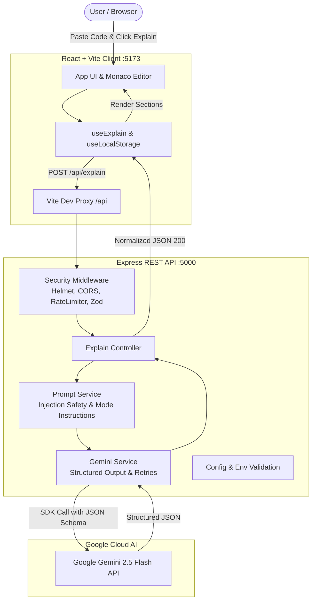

# Explain My Code AI

[](https://nodejs.org/)
[](https://react.dev/)
[](https://ai.google.dev/)
[](LICENSE)

**Explain My Code AI** is a full-stack developer productivity platform that provides structured, multi-tier natural-language code explanations powered by the **Google Gemini API**. Paste source code in any language, select your desired depth, and receive structured explanations with Big-O complexity analysis, line-by-line walkthroughs, key conceptual breakdowns, and interview follow-up questions.

---

## Table of Contents
- [Features](#features)
- [Pages & Navigation](#pages--navigation)
- [Explanation Modes](#explanation-modes)
- [Tech Stack](#tech-stack)
- [System Architecture](#system-architecture)
- [Project Structure](#project-structure)
- [Getting Started](#getting-started)
  - [Prerequisites](#prerequisites)
  - [Obtaining a Gemini API Key](#obtaining-a-gemini-api-key)
  - [Installation & Setup](#installation--setup)
- [Environment Variables](#environment-variables)
- [API Documentation](#api-documentation)
- [Running Tests](#running-tests)
- [UI Screenshots](#ui-screenshots)
- [Security & Prompt Safety](#security--prompt-safety)
- [License](#license)

---

## Features

- **Multi-Level Explanations**: 4 tailored explanation personas designed for everyone from total newcomers to senior engineers preparing for Big Tech interviews.
- **Structured Output**: Clear, modular sections rather than walls of text (Executive Overview, Line-by-Line walkthrough badges, Key Concepts chips, Big-O Complexity, Potential Issues, and Recommended Improvements).
- **Technical Interview Mode**: Explains solutions with candidate-style confidence and automatically generates 3–5 high-yield follow-up questions with model answers.
- **Code Editor**: Monaco-powered code editor with syntax highlighting for 16+ languages, line numbers, and keyboard shortcut (`Ctrl/Cmd + Enter`).
- **Prompt Injection Defense**: Strict server-side delimiters and system instructions ensure submitted source code is treated purely as untrusted data.
- **Export & Productivity Tools**: One-click "Copy as Markdown" and "Export .md" file download.
- **Explanation History**: Persists the last 10 explanations locally with fast restore and clearing.
- **Responsive Dark/Light UI**: Glassmorphic, modern design optimized for mobile (375px+), tablet, and desktop screens.

---

## Pages & Navigation

The frontend is organized into clean, client-side routed pages using React Router (`react-router-dom`):

- **`/` — Home Page**:
  - **Hero Section**: Value proposition headline, "Try it now" and "See how it works" buttons, and an interactive mock preview card showing code transforming into structured explanation cards.
  - **How It Works**: 3-step visual workflow (Paste code → Choose language & level → Get structured explanation).
  - **Explanation Modes**: 4 interactive mode cards (Beginner, Intermediate, Advanced, Interview) each linking directly to `/explain?mode=<mode>` with query parameter preselection.
  - **Features Grid**: 6 scannable capability cards highlighting line-by-line badges, key concepts, complexity, issues, interview Q&A, and markdown export.
  - **Supported Languages**: Multi-language chips for 16+ languages plus automatic detection.
  - **Call to Action**: High-conversion closing banner with direct access to the explainer studio.

- **`/explain` — Explain Code Studio**:
  - The core AI explanation platform with Monaco Code Editor, live character counter, example loader, language & mode selectors, structured output renderer, and local history drawer.
  - Preselects the explanation mode dynamically via the `?mode=<mode>` URL query parameter (e.g. `/explain?mode=interview`).

- **`*` — 404 Not Found Page**:
  - Friendly fallback page with instant navigation back to Home or the Explainer studio.

- **Shared Components**:
  - **Navbar**: Sticky navigation featuring the brand logo, active route highlighting via `NavLink`, GitHub profile link (`@aayeshamadiha9`), dark/light theme toggle, and a responsive mobile drawer menu.
  - **Footer**: Brand tagline, quick navigation links, GitHub link, and credit: "Built by Aayesha Madiha".


---

## Explanation Modes

| Mode | Target Audience | Focus & Characteristics |
| :--- | :--- | :--- |
| **Beginner** | Absolute beginners & non-programmers | Plain language, intuitive analogies, zero unnecessary jargon, patient explanation of core concepts. |
| **Intermediate** | Developers with foundational skills | Focuses on control flow, data transformations, standard idioms, and why the code was designed this way. |
| **Advanced** | Senior engineers & systems architects | Deep technical rigor, memory/runtime internals, Big-O analysis, concurrency implications, edge cases, and optimizations. |
| **Interview** | Tech candidates (FAANG/Big Tech prep) | Whiteboard candidate walkthrough style + 3 to 5 realistic interview follow-up questions with sharp model answers. |

---

## Tech Stack

- **Frontend**:
  - React.js (Vite)
  - Plain CSS Design System (Custom variables, glassmorphism, responsive grid)
  - `@monaco-editor/react` (Monaco code editor)
  - `axios` (HTTP client with timeout handling)
  - `lucide-react` (Lightweight icon system)
- **Backend**:
  - Node.js & Express.js REST API
  - Official Google GenAI SDK (`@google/genai` & `@google/generative-ai`)
  - `zod` (Strict schema validation)
  - `helmet` & `cors` (HTTP header security & origin restrictions)
  - `express-rate-limit` (20 requests / 15 minutes per IP)
  - `morgan` (Structured request logging)
- **Testing**:
  - Jest & Supertest (Comprehensive integration tests)

---

## System Architecture



---

## Project Structure

```
explain-my-code-ai/
├── client/                      # React frontend (Vite)
│   ├── src/
│   │   ├── components/          # UI components
│   │   │   ├── CodeEditor.jsx   # Monaco code editor with shortcuts
│   │   │   ├── LanguageSelect.jsx # Language dropdown (Auto + 16 languages)
│   │   │   ├── ModeSelector.jsx # Segmented control for 4 modes
│   │   │   ├── ExplanationView.jsx # Structured card visualizations
│   │   │   ├── HistoryPanel.jsx # Recent explanations drawer
│   │   │   ├── Loader.jsx       # Skeleton pulse & live tips
│   │   │   ├── ErrorBanner.jsx  # Dismissible error notifications
│   │   │   └── Header.jsx       # Branding, theme toggle, health indicator
│   │   ├── services/
│   │   │   └── api.js           # Axios API client
│   │   ├── hooks/
│   │   │   ├── useExplain.js    # AI explanation lifecycle hook
│   │   │   └── useLocalStorage.js # Local storage synchronization
│   │   ├── data/
│   │   │   └── examples.js      # Sample snippets for "Load Example"
│   │   ├── App.jsx              # Main layout & coordinator
│   │   ├── main.jsx             # React entrypoint
│   │   └── index.css            # Complete design system & tokens
│   ├── index.html
│   ├── vite.config.js           # Vite dev proxy configuration
│   └── package.json
├── server/                      # Express backend
│   ├── src/
│   │   ├── routes/              # health.routes.js, explain.routes.js
│   │   ├── controllers/         # explain.controller.js
│   │   ├── services/            # gemini.service.js, prompt.service.js
│   │   ├── middleware/          # validate.js, errorHandler.js, rateLimiter.js
│   │   ├── config/              # env.js
│   │   ├── app.js               # Express app configuration
│   │   └── server.js            # Server entrypoint
│   ├── __tests__/               # Jest & Supertest integration tests
│   ├── .env.example             # Example environment file
│   └── package.json
├── README.md
└── package.json                 # Root script runner (concurrently)
```

---

## Getting Started

### Prerequisites

- **Node.js**: v18.0.0 or higher
- **npm**: v9.0.0 or higher

### Obtaining a Gemini API Key

1. Visit [Google AI Studio](https://aistudio.google.com/).
2. Sign in with your Google Account.
3. Click **"Get API key"** and create a key in a new or existing project.
4. Copy the API key (format starts with `AIzaSy...`).

### Installation & Setup

1. **Clone the repository**:
   ```bash
   git clone https://github.com/your-username/explain-my-code-ai.git
   cd explain-my-code-ai
   ```

2. **Install all dependencies** (root, server, and client):
   ```bash
   npm install
   npm install --prefix server
   npm install --prefix client
   ```

3. **Configure Environment Variables**:
   Create a `.env` file inside `server/`:
   ```bash
   cp server/.env.example server/.env
   ```
   Edit `server/.env` and insert your Gemini API Key:
   ```env
   PORT=5000
   GEMINI_API_KEY=AIzaSyYourActualApiKeyHere
   GEMINI_MODEL=gemini-2.5-flash
   CLIENT_ORIGIN=http://localhost:5173
   MAX_CODE_LENGTH=8000
   ```

4. **Start the application** (Runs both Client and Server concurrently):
   ```bash
   npm run dev
   ```

5. **Open your browser**:
   Navigate to [http://localhost:5173](http://localhost:5173).

---

## Environment Variables

| Variable | Required | Default | Description |
| :--- | :---: | :---: | :--- |
| `PORT` | No | `5000` | Port on which the Express server listens. |
| `GEMINI_API_KEY` | **Yes** | — | Google Gemini API key. Server fails fast at startup if missing. |
| `GEMINI_MODEL` | No | `gemini-2.5-flash` | Gemini model ID (e.g. `gemini-2.5-flash`, `gemini-1.5-flash`). |
| `CLIENT_ORIGIN` | No | `http://localhost:5173` | Allowed frontend URL for CORS policy. |
| `MAX_CODE_LENGTH` | No | `8000` | Maximum allowed character count for code snippets. |
| `MOCK_GEMINI` | No | `false` | When `true`, enables offline mock AI responses for testing. |

---

## API Documentation

### 1. Health Check
`GET /api/health`

**Response (`200 OK`)**:
```json
{
  "status": "ok",
  "uptime": 142
}
```

---

### 2. Supported Metadata
`GET /api/meta`

**Response (`200 OK`)**:
```json
{
  "languages": [
    "JavaScript", "TypeScript", "Python", "Java", "C", "C++",
    "C#", "Go", "Rust", "PHP", "Ruby", "Kotlin", "Swift",
    "SQL", "HTML/CSS", "Bash"
  ],
  "modes": [
    "beginner",
    "intermediate",
    "advanced",
    "interview"
  ]
}
```

---

### 3. Explain Code
`POST /api/explain`

**Request Headers**: `Content-Type: application/json`

**Request Body**:
```json
{
  "code": "def fib(n, memo={}):\n    if n in (0, 1): return n\n    if n not in memo:\n        memo[n] = fib(n-1, memo) + fib(n-2, memo)\n    return memo[n]",
  "language": "Python",
  "mode": "intermediate"
}
```

**Success Response (`200 OK`)**:
```json
{
  "language": "Python",
  "mode": "intermediate",
  "explanation": {
    "overview": "This Python function computes the n-th Fibonacci number using recursion enhanced with memoization to avoid redundant computations.",
    "stepByStep": [
      {
        "lines": "1",
        "explanation": "Defines the fib function taking n and a default dictionary memo to cache previous results."
      },
      {
        "lines": "2",
        "explanation": "Base condition: returns n directly if n is 0 or 1."
      },
      {
        "lines": "3-4",
        "explanation": "If n is not in memo, recursively calculates fib(n-1) and fib(n-2) and stores the sum."
      },
      {
        "lines": "5",
        "explanation": "Returns the cached value for n."
      }
    ],
    "keyConcepts": [
      {
        "name": "Memoization",
        "description": "Caching expensive function results to optimize recursive performance."
      },
      {
        "name": "Dynamic Programming",
        "description": "Breaking problems into overlapping subproblems solved top-down."
      }
    ],
    "complexity": {
      "time": "O(n)",
      "space": "O(n)",
      "notes": "Computes each number from 0 to n once; requires linear stack and dictionary storage."
    },
    "potentialIssues": [
      "Using a mutable default argument (memo={}) shares state across multiple calls. Prefer memo=None."
    ],
    "improvements": [
      "Use functools.lru_cache for cleaner, standard library-supported caching."
    ],
    "interviewQuestions": []
  },
  "meta": {
    "model": "gemini-2.5-flash",
    "latencyMs": 1180
  }
}
```

---

### Standard Error Shapes

All errors follow a unified response schema:
```json
{
  "error": {
    "code": "VALIDATION_ERROR",
    "message": "Code snippet cannot be empty or solely whitespace."
  }
}
```

| HTTP Status | Error Code | Scenario |
| :---: | :--- | :--- |
| **400** | `VALIDATION_ERROR` | Empty code, unsupported language, or invalid mode. |
| **413** | `PAYLOAD_TOO_LARGE` | Code exceeds `MAX_CODE_LENGTH` (8,000 characters). |
| **429** | `RATE_LIMIT_EXCEEDED`| More than 20 requests per 15 minutes per IP. |
| **502** | `GEMINI_FAILURE` | Gemini API network failure, quota exceeded, or invalid key. |
| **500** | `INTERNAL_SERVER_ERROR` | Unhandled internal exception (sanitized, no leaked secrets). |

---

## Running Tests

Run backend unit and integration tests:
```bash
npm test
```
Or directly inside the server directory:
```bash
cd server
npm test
```

Test coverage includes:
- `GET /api/health` status and uptime
- `GET /api/meta` supported languages and modes
- Input validation (missing code, empty string, unsupported language, invalid mode)
- Payload size boundaries (`413 Payload Too Large`)
- Successful multi-mode explanations (Beginner, Interview questions)
- Auto-detect language handling
- 502 error propagation on upstream Gemini failure

---

## UI Screenshots

| Desktop Workspace | Interview Mode & Accordion |
| :---: | :---: |
| *(Editor side-by-side with structured explanation sections)* | *(Deep-dive questions with model answers and Big-O card)* |

---

## Security & Prompt Safety

1. **Zero Secret Leakage**: The Gemini API key is strictly maintained on the backend server. It is never exposed in browser bundles, network headers, or responses.
2. **Prompt Injection Guard**: User code is wrapped inside explicit `<SOURCE_CODE>` delimiters with strict system directives instructing the model to treat the content solely as data and ignore instructions within it.
3. **Fail-Fast Booting**: If `GEMINI_API_KEY` is missing or contains placeholder text, the server refuses to boot with an explicit configuration warning.
4. **Rate Limiting & Helmet**: Standard defense against brute-force calls and HTTP header spoofing.

---

## License

This project is licensed under the MIT License.
